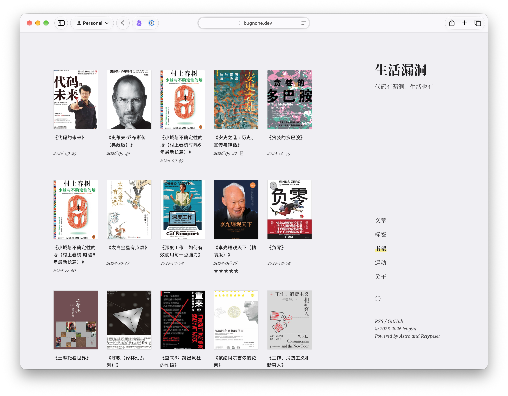
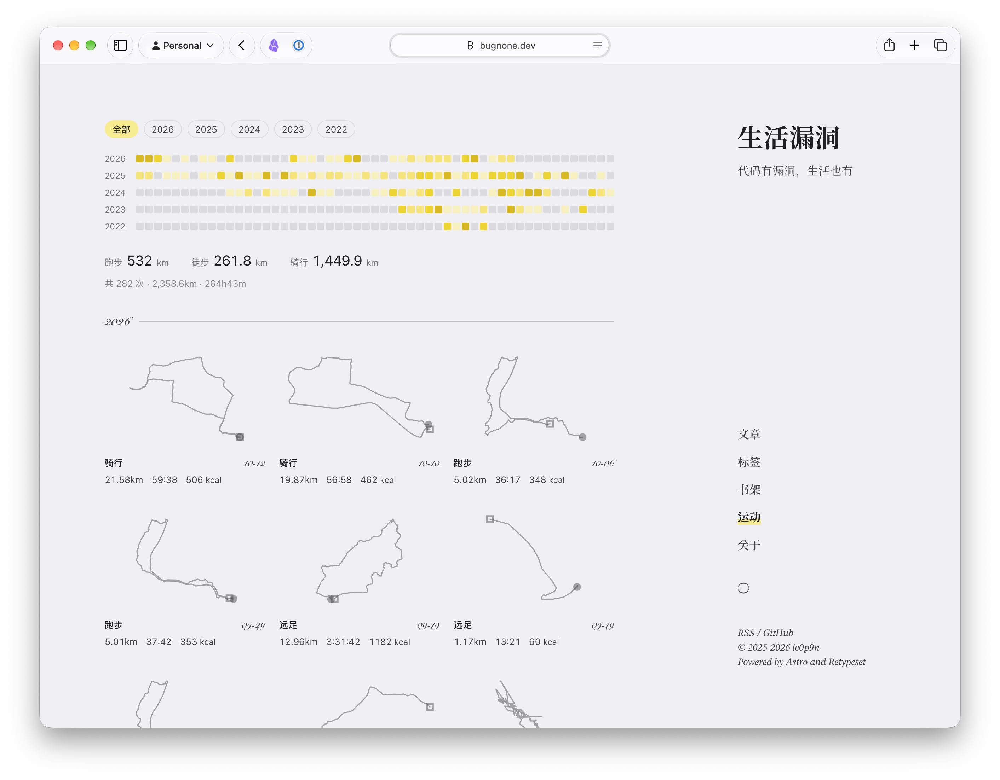

去年这个时候既兴奋又沮丧，兴奋的是 LLM 和 Coding Agent 实在是越来越强大。那会儿的模型已经非常强大，并且能干很多的事情，沮丧是因为 AI 带来的失控和焦虑。没想到一年过去了，虽然用 AI 完成了很多任务，但兴奋和沮丧还是没有太大的改变。

转眼一年过去了。这一年里，从 CLI、SKILL、harness，再到近期流行的 bot，总之，概念每天都有新的，淘汰的速度也变快了。当然各个厂商模型依旧隔三差五发 SOTA，但 Opus 依旧大杀四方，OpenAI 模型降至，但是 Reset 成瘾，总之 Vibe Coding 软件井喷，当然 Anthropic 还在封号。

越来越多的人涌进了研发的赛道，不管看得懂看不懂代码，懂产品验收就行。而你会发现，那些不会代码的人也能构建出优秀、优雅、好用的软件，重要的是对 LLM 的运用，对产品的 taste 和 insight。代码的壁垒虽然消除了，但是永远是平庸的人构建平庸的程序，卓越的人造就不凡。LLM 的出现只会拉大人和人之间的距离，职场老白兔们将会加速被淘汰。

但是，这个时代真是太好了：软件个性化的时代，一言不合就给自己开个小 feature，实现只适合自己的功能。这不，又给 blog 增加了 books 和 sport，不会前端也无所谓，只要注意“安全”即可。

